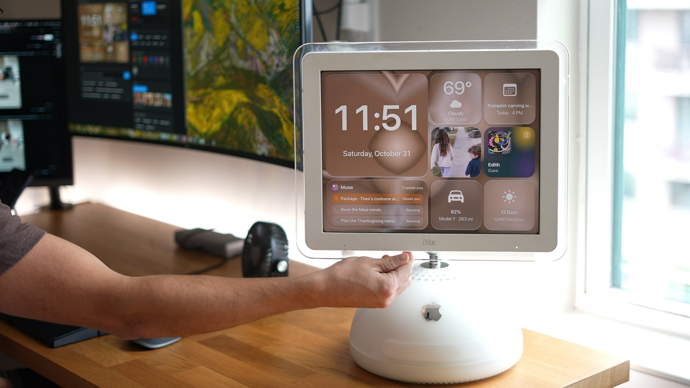
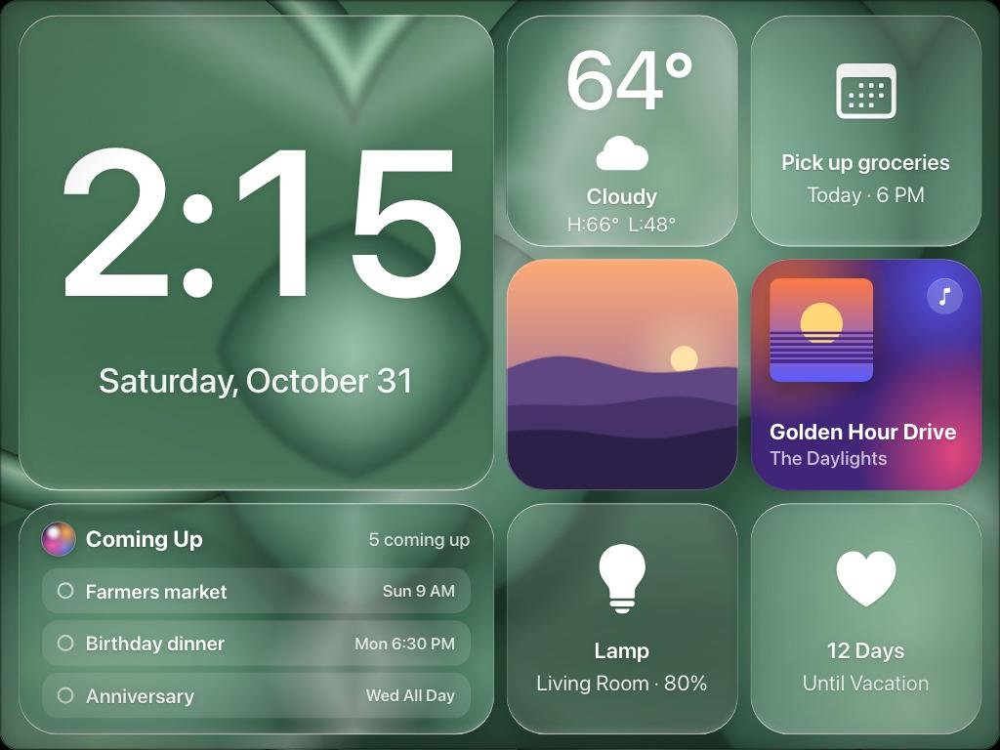
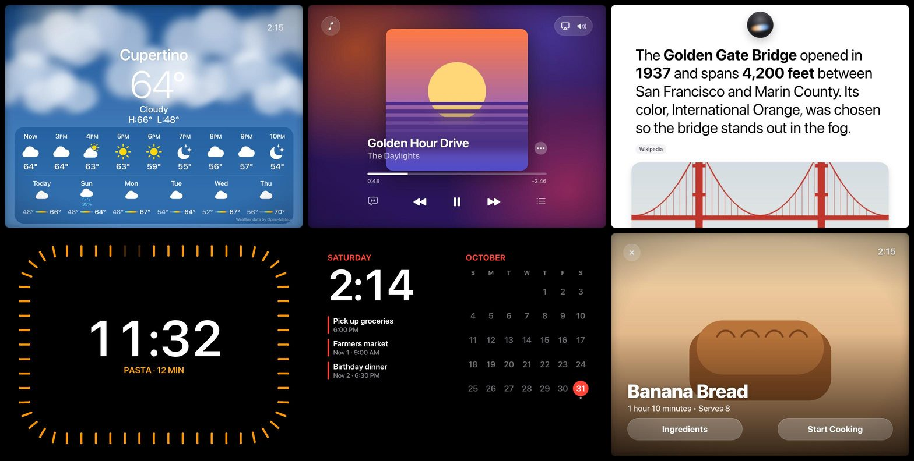

# HomeView for iMac G4

**What you need:** an iMac G4 running Mac OS X 10.4 Tiger, any modern Mac, one Ethernet cable.



Turn an old iMac G4 (the "lamp" iMac, Mac OS X 10.4 Tiger) into a HomeView-style smart display, with a clock, weather,
calendar, music, photos, timers, recipes, smart-home controls and a voice assistant you wake by saying "Hey Apple".

A modern Mac does the heavy lifting. It renders every screen with real macOS fonts and frosted glass and runs the voice
assistant. The G4 runs one small Java app that shows the screens, sends taps and streams its microphone back. One
Ethernet cable connects the two.





> **Not affiliated with Apple.** This is an independent hobby project inspired by the look of Apple's HomeView. It is not
> made, endorsed or supported by Apple. Apple, iMac, HomeView, Siri, HomePod and Mac OS X are trademarks of Apple Inc.
> No Apple code, fonts or artwork are included. The pop-ups use the fonts already on your Mac.

The photo shows the author's own iMac in demo mode; the screenshots are renders from demo mode, which uses made-up
sample data and drawn placeholder pictures.

## What you need

- **An iMac G4** running **Mac OS X 10.4 Tiger** with Java (Tiger includes it). Other PowerPC Macs on Tiger should work too.
- **A modern Mac** running macOS 13 Ventura or later. It needs:
  - **Python 3.9 to 3.12** with Pillow (and NumPy if you want camera touch). The `/usr/bin/python3` from the Xcode
    Command Line Tools works. Python 3.13 removed the `audioop` module the voice service uses, so on 3.13 also run
    `pip install audioop-lts`.
  - **Google Chrome**, which renders the screens headlessly in the background.
  - **The Xcode Command Line Tools** (`xcode-select --install`), to build the small Swift helper apps.
- **One Ethernet cable** from the G4 to the Mac (a USB-C or Thunderbolt Ethernet adapter is fine). The two Macs give
  themselves self-assigned 169.254.x.x addresses, so you don't need a router or any network setup.
- Optional: an **OpenAI API key** for answers to general questions and a natural voice, **Spotify** on the Mac,
  **Home Assistant** for lights, scenes, cameras and a doorbell, and a **USB webcam** for "camera touch".

## How it works

```
 iMac G4 (Tiger)                                    Modern Mac
┌────────────────────┐    Ethernet     ┌──────────────────────────────────────────────────────┐
│ HomeView.jar       │ ─────────────── │ relay.py      :8090  the only port the G4 talks to   │
│  shows each screen │  frames, taps,  │   ├─ server.py   :8878  renders screens with headless │
│  draws clock hands │  mic audio,     │   │                     Chrome, draws pop-ups, taps   │
│  and the Siri glow │  spoken replies │   └─ voice.py    :8879  wake word, commands, timers,  │
│  streams the mic   │                 │                         OpenAI answers, speech        │
│  plays replies     │                 │   HomeViewSpeech.app  on-device speech recognition   │
└────────────────────┘                 │   HomeViewCalendar.app  reads the Mac's Calendar     │
                                       └──────────────────────────────────────────────────────┘
```

- `server.py` builds the screens ("faces") in HTML (`static/faces.js` and `faces.css`) and screenshots them at 1024x768
  with headless Chrome. It writes a JPEG and a small JSON file describing the frame. Pop-ups such as timers, banners, the
  answer card and the doorbell are drawn separately by `overlays.py` as small images the G4 places on top. The G4 never
  has to blur or render text itself.
- `voice/voice.py` receives the G4's microphone audio and feeds it to `HomeViewSpeech.app`, which uses Apple's on-device
  speech recognition. After the wake word, home and screen commands, timers, weather and music run locally and right
  away (`voice/intents.py`). Other questions go to OpenAI if you've added a key. Replies are spoken with OpenAI's voice or
  the Mac's own voice and played on the G4's speaker.
- `relay.py` is the only thing listening on the network. It accepts connections from link-local addresses and the Mac
  itself, and passes requests to the other two services, which listen on 127.0.0.1 only.
- `g4-viewer/HVViewer.java` runs full screen on the G4. It pulls new frames when they change, slides between screens,
  draws the analog clock hands and the edge glow itself so they move smoothly, sends clicks as taps, streams the mic
  and plays replies.

## Setup on the Mac

### 1. Get the code and install the Python packages

```bash
git clone https://github.com/<you>/homeview-g4.git
cd homeview-g4
/usr/bin/python3 -m pip install --user pillow numpy
```

### 2. Create your config

```bash
cp config.example.json config.json
```

Open `config.json` and set at least your **location** (name, latitude and longitude for the weather). Everything else is
optional. `config.json` is git-ignored, so your settings and keys never get committed. If you put a Home Assistant
token or OpenAI key in it, make it readable only by you: `chmod 600 config.json`. The full list is in
[Configuration](#configuration).

### 3. Build the helper apps

```bash
helpers/build.sh
```

This builds `HomeViewSpeech.app` (speech recognition), `HomeViewCalendar.app` (your Calendar) and `HomeViewTouch.app`
(optional camera touch) into `helpers/build/`. They're signed ad hoc on your Mac. macOS asks for permission the first
time each one runs.

### 4. Try it by hand

Run each service in its own Terminal tab:

```bash
python3 server.py
```

```bash
python3 relay.py
```

```bash
python3 voice/voice.py
```

Open **http://127.0.0.1:8878/remote** on the Mac. This control page shows what the G4 would show and has buttons for
every screen, the demo modes, wallpapers, photos and a "Say it" box that runs a command as if you'd spoken it. Try
**Demo info** or **45-second tour** to see every screen with sample data.

The first time `voice.py` starts it opens `HomeViewSpeech.app`. Click **Allow** when macOS asks about Speech Recognition.

### 5. Install the services so they start at login

```bash
launchd/install.sh
```

This copies the project to `~/Library/Application Support/HomeView/app` (launchd can't read your Documents or Desktop
folder) and installs three LaunchAgents: `local.homeview.server`, `local.homeview.relay` and `local.homeview.voice`. They
start at login and restart if they crash. Logs go to `~/Library/Logs/HomeView/`; `voice.log` records the commands you
give after the wake word and the answers, so treat it as private. The dashboard runs under `caffeinate`, so the Mac
won't go to sleep on its own while you're logged in (close the lid or sleep it yourself when you want to). **Run
`install.sh` again after you edit `config.json` or update the code.** To remove the services, run
`launchd/uninstall.sh`; add `--all` to also delete the runtime copy and logs (your `config.json`, photos and the data
folder stay).

Because the helper apps are copied too, macOS may ask for Speech Recognition and Calendar permission once more for the
installed copies.

### 6. Let the G4 reach the Mac

1. Plug the Ethernet cable into both Macs.
2. On the Mac, find its local hostname in **System Settings > General > Sharing**, at the bottom (for example
   `my-mac.local`).
3. If the macOS firewall is on, allow incoming connections for `python3` when asked, or add it in **System Settings >
   Network > Firewall > Options**.
4. On the G4, open Safari and go to `http://my-mac.local:8090/`. You should see the dashboard, refreshing every 10
   seconds. This plain page also works as a fallback if you skip the Java viewer.

## Building and running the viewer on the G4

The viewer is plain Java 1.4 (no generics or other newer syntax), so Tiger's built-in Java runs it. The simplest way is
to build it on the G4 itself, which is how the original was built.

1. Copy the `g4-viewer` folder to the G4 (a USB stick, File Sharing, or `scp`), for example to `~/HVViewer`.
2. On the G4, open **Terminal**:

   ```bash
   cd ~/HVViewer
   sh build.sh
   ```

   If `javac` is missing, install the Xcode Tools from the Tiger install disc.
3. Tell the viewer where your Mac is. Put one line in `~/HVViewer/server.txt`:

   ```bash
   echo "http://my-mac.local:8090" > ~/HVViewer/server.txt
   ```

   Use the Mac's `.local` name rather than its 169.254.x.x address, which can change. You can also pass the address as
   the first argument: `java -jar HomeView.jar http://my-mac.local:8090`.
4. Run it: `java -jar HomeView.jar`, or double-click `HomeView.jar`. It goes full screen. Press **Esc** or **Cmd-Q** to quit.
5. To start it automatically, open **System Preferences > Accounts > Login Items** on the G4 and add `HomeView.jar`.
   Turn on automatic login and set Energy Saver so the display doesn't sleep. The viewer keeps the screen awake by
   itself, except from 1 to 6 AM.

You can also build the jar on the modern Mac with any JDK that still supports old class files (JDK 8 accepts
`-source 1.4 -target 1.4` with a warning; newer JDKs need at least `--release 8`, which Tiger's Java can't run).

## Voice setup

- **Speech Recognition permission.** `HomeViewSpeech.app` does the recognition on your Mac with Apple's Speech framework.
  The first launch asks for permission. If you missed it, turn it on in **System Settings > Privacy & Security > Speech
  Recognition**. The Mac's own microphone is never used. The audio comes from the G4.
- **The G4's microphone.** On the G4, open **System Preferences > Sound > Input**, pick the internal microphone and set
  the input volume fairly high.
- **Wake word.** The default is "Hey Apple". To change it, set `assistant.wake_names` (the word or words after "hey",
  lowercase) and `assistant.wake_word` (how it's shown). Short, distinct words work best.
- **OpenAI key (optional).** Without a key, the assistant handles lights and scenes, screens, timers, weather, music,
  your calendar, recipes you've opened and the demos, and speaks with the Mac's built-in voice. With a key, it also
  answers general questions (with web search when a question needs live info), finds recipes and songs, and speaks
  with OpenAI's voice. Add the key in one of three ways:
  - the **OpenAI** box on the `/remote` page, which saves it to `~/.config/homeview/openai.env` with owner-only permissions;
  - `"openai_api_key"` in `config.json`;
  - the `OPENAI_API_KEY` environment variable.

  Usage is billed to your OpenAI account; a question is one or two short requests. To answer well, each request
  includes the time, your location name and weather, what's playing, your running timers and the titles of your
  upcoming calendar events, so those go to OpenAI along with your words. Nothing is sent to OpenAI when no key is set.

Things to try, each starting with "Hey Apple":

| Say | What happens |
|---|---|
| "What's the weather?" | Weather screen, plus the forecast read aloud |
| "Set a 10 minute timer for pasta" | Full-screen timer that shrinks to a capsule when you move on |
| "Turn on the lamp" / "Set the lamp to 40 percent" / "Movie time" | Home Assistant devices and scenes from your config |
| "Play Hello by Adele" / "Pause" / "Next song" / "Show the lyrics" | Spotify on the Mac, with synced lyrics |
| "What's on my calendar this week?" | An agenda page built from your Calendar |
| "Let's make banana bread" | A recipe card, then "next step" through the steps (needs an OpenAI key) |
| "Show the front door" / "Announce dinner is ready" | Doorbell camera, or Home Assistant speakers |
| "Show me what you can do" | The 45-second tour |
| "Demo mode" / "Stop the demo" | The scripted demo, with sample data and fixed answers |

After an answer, it keeps listening for about 8 seconds, so you can ask a follow-up without the wake word.

## Configuration

All settings live in `config.json`. Anything you leave out keeps its default from `homeview_config.py`.

| Setting | What it does |
|---|---|
| `ports` | `dashboard` 8878, `voice` 8879, `relay` 8090 (the port the G4 uses), `speech` 8880, `chrome_devtools` 9333 |
| `relay_bind` | The address the relay listens on. `0.0.0.0` (every interface) by default; set the Mac's Ethernet address to limit it to that cable |
| `relay_allowed_networks` | Who may connect to the relay. Default: link-local `169.254.0.0/16` and the Mac itself |
| `location` | `name`, `latitude`, `longitude`, `timezone` (`auto`) and `units` (`fahrenheit` or `celsius`) for the weather |
| `owner_name` | Optional name for the greeting and the morning brief |
| `assistant` | `name` shown on screen, `wake_word`, `wake_names`, `openai_model`, `openai_voice`, `mac_voice` |
| `openai_api_key` | Optional. See [Voice setup](#voice-setup) |
| `photos_dir` | A folder of your own `.jpg`/`.png` photos for the Photo face and widgets. Default: `<data_dir>/photos` |
| `data_dir` | Where state files go. Default: `~/Library/Application Support/HomeView/data` |
| `countdown` | `{"label": "Vacation", "date": "2027-06-01"}` shows a countdown tile on the Home face |
| `night` | Hours for the red Night face (default 23 to 7) |
| `spotify.enabled` | Show and control the Spotify app on this Mac |
| `demo` | Optional `song_uri` (`spotify:track:...`) and `song_name` for the scripted demo's "play the demo song" |
| `home_assistant` | `url`, `token` (a long-lived access token from your Home Assistant profile) and `devices`, plus optional doorbell and announcement entities. With an `http://` URL the token crosses your LAN unencrypted, as with any Home Assistant client |
| `calendar_helper` | Run `HomeViewCalendar.app` to read the Mac's Calendar |
| `touch.enabled` | Camera touch (see below) |
| `chrome_path` | Where Google Chrome is |

### Home Assistant devices

List the devices you want on the Lights grid and controllable by voice. Supported domains are `light`, `fan`, `scene`,
`cover` (shades) and `media_player`. The first device also appears as a tile on the Home face.

```json
"home_assistant": {
  "url": "http://homeassistant.local:8123",
  "token": "<long-lived access token>",
  "devices": [
    { "entity_id": "light.living_room_lamp", "name": "Lamp", "room": "Living Room" },
    { "entity_id": "light.office", "name": "Office Lights", "room": "Office" },
    { "entity_id": "fan.bedroom", "name": "Fan", "room": "Bedroom" },
    { "entity_id": "scene.movie_time", "name": "Movie", "room": "Living Room" },
    { "entity_id": "cover.living_room_shades", "name": "Shades", "room": "Living Room" }
  ]
}
```

The **Cameras** screen shows up to nine Home Assistant cameras. A **doorbell** press (an `event` entity with device class
`doorbell`, or the one you set in `doorbell_event`) shows the Front Door card with the camera picture and plays a chime.
**Announcements** use Home Assistant's `tts.speak` on your HomePod or Sonos speakers, or the `announce_players` you list.

### Optional extras

- **Your photos.** Put photos in `photos_dir`. The Home face shows one and the Photo face rotates them. For the Photo
  face's depth effect, where people stand in front of the time, make masks into `<data_dir>/masks`:

  ```bash
  M="$HOME/Library/Application Support/HomeView/data/masks"; mkdir -p "$M"
  helpers/build/personmask <photos_dir> "$M" && python3 helpers/mask_stats.py "$M"
  ```
- **Calendar.** `HomeViewCalendar.app` reads every account in the Mac's Calendar app (iCloud, Google, Exchange) and
  writes the next 7 days to `<data_dir>/calendar.json` every 2 minutes. Allow Calendar access when asked.
- **Spotify.** The Mac's Spotify app is controlled through AppleScript. macOS asks once whether Python may control
  Spotify. No Spotify account details are needed or stored.
- **Camera touch.** Point a USB webcam at the G4's screen, set `"touch": {"enabled": true}`, reinstall, and say "Hey Apple,
  calibrate touch". Touch each target and hold. Afterwards, holding a fingertip still on the screen taps and a quick
  sideways sweep swipes. The video stays on the Mac; for checking accuracy, a marked webcam frame of each tap is kept
  in `<data_dir>/taps` (the last 12).
- **Demo modes** (on `/remote` or by voice). *Demo info* keeps everything working but shows sample data, which is good for
  screenshots. *Scripted demo* makes the lines on the `/remote` page answer the same way every time. *B-roll* loops
  every screen slowly. *45-second tour* shows everything quickly. Demo pictures are in `static/demo/`. Regenerate them
  with `python3 tools/make_demo_images.py`, or replace them with your own.

## What's exposed on the network

Only `relay.py` accepts connections from other machines. The dashboard, the voice service and the speech helper
listen on `127.0.0.1` and can't be reached from outside the Mac. The relay answers only addresses in
`relay_allowed_networks` (by default the 169.254.x.x range two directly cabled Macs use, plus the Mac itself) and
exposes just what the viewer needs: the current screen image, the pop-up images, taps, the microphone stream in and
spoken replies out. That is still a lot: whoever can reach that port sees whatever is on the screen (calendar, photos,
cameras, answers), reads the live transcript, hears the replies, and can send audio, which means giving any voice
command, including Home Assistant controls and announcements. So keep it on the cable: if the Mac is also on Wi-Fi or
a shared network, set `relay_bind` to the Ethernet interface's address (see `ifconfig`). The `/remote` control page,
`/api/data` and the OpenAI key are never reachable through the relay.

Your OpenAI key is stored only on the Mac, in `config.json` or in `openai_key_file` with owner-only permissions, and is
sent only to `api.openai.com`. Besides OpenAI (optional) and Home Assistant (optional), the Mac talks to Open-Meteo
(your coordinates, for weather), LRCLIB (song title and artist, for lyrics), Wikipedia (key words of a question, for the
answer card's picture) and Spotify's image CDN (album covers).

## Troubleshooting

**The G4 shows nothing or a black screen.**
On the G4, open `http://my-mac.local:8090/hv.json` in Safari. If it doesn't load, check the cable, the Mac's
hostname, the firewall, and that `relay.py` is running (`~/Library/Logs/HomeView/relay.log`). If `.local` names don't
resolve, use the Mac's 169.254.x.x address from `ifconfig` in `server.txt` for now. If you changed
`relay_allowed_networks`, make sure it still includes the G4's address.

**The screen never updates or the server log shows render errors.**
Check that Google Chrome is at `chrome_path`. Then look at `~/Library/Logs/HomeView/server.log` and at
`http://127.0.0.1:8878/remote` on the Mac. A stuck headless Chrome is killed and restarted automatically after three
failed renders.

**Pop-ups such as timers and banners are missing.**
They need Pillow for the Python that runs `server.py`, and the system fonts at `/System/Library/Fonts/SFNS.ttf`.

**"Hey Apple" does nothing.**
Open `http://127.0.0.1:8879/voice-state` on the Mac:
- `chunks` should keep rising. If it doesn't, no audio is arriving: check the G4's input device and volume and that the
  viewer is running.
- `speech_app` should be `true`. If it isn't, allow Speech Recognition for HomeView Speech in System Settings, then
  restart the voice service.
- If both look fine, the recognizer is probably mishearing the wake word. Type commands in the `/remote` page's
  "Say it" box to check the rest works, try speaking closer to the G4, or pick a different wake word.

**It answers commands but not questions.**
Add an OpenAI key (see [Voice setup](#voice-setup)). Check `voice.log` for `openai` errors such as an invalid key or no credit.

**No calendar events.**
Make sure `helpers/build.sh` was run and Calendar access was allowed for HomeView Calendar. Check that
`<data_dir>/calendar.json` exists and has `"ok": true`.

**Music doesn't show or won't play.**
Open Spotify on the Mac and allow the Automation prompt. If you missed it, turn it on in **System Settings > Privacy &
Security > Automation**.

**The voice service crashes with `No module named 'audioop'`.**
You're on Python 3.13 or newer. Run `pip install audioop-lts`, or use `/usr/bin/python3` (`PYTHON=/usr/bin/python3 launchd/install.sh`).

**The viewer runs out of memory or gets slow on the G4.**
Tiger's Java gives it a 64 MB heap. The viewer clears its pop-up cache when memory runs low. It writes timing to
`~/HVViewer/perf.log` if that folder exists.

**The G4's clock is wrong.**
The relay serves the Mac's UTC time at `/time`. On the G4: `sudo date -u $(curl -s http://my-mac.local:8090/time)`.

## Project layout

```
server.py              dashboard: data, rendering, taps, demo modes, /remote control page
overlays.py            pop-ups drawn on the Mac (timers, banners, answer card, doorbell, alarms)
relay.py               the only network-facing service; passes the G4's requests through
homeview_config.py     loads config.json over the defaults
config.example.json    copy to config.json
static/                faces.js / faces.css (the screens), remote.html, icons, demo placeholder pictures
voice/                 voice.py (assistant), intents.py (local command parser)
helpers/               Swift helpers (speech, calendar, camera touch, person masks) and build.sh
g4-viewer/             HVViewer.java (the G4 app), build.sh, manifest.txt, server.txt.example
launchd/               LaunchAgent templates, install.sh, uninstall.sh
tools/                 make_demo_images.py, icons.py (rebuilds static/icons.js)
```

## License

[MIT](LICENSE). Icon credits and other notices are in [THIRD_PARTY_NOTICES.md](THIRD_PARTY_NOTICES.md).
